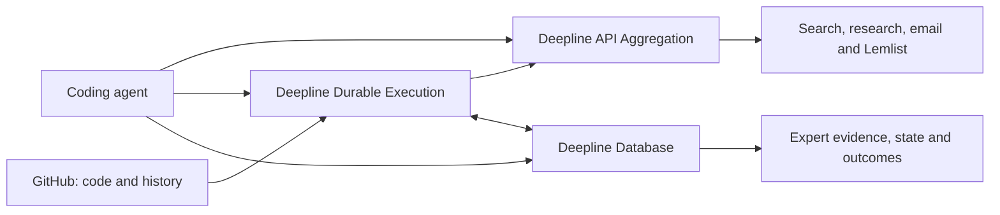

# State, data and recovery

A state says where an expert is. A Play does the work between states. The database retains the inputs, outputs and reasons, so an agent can explain a result and choose the next action.

## Synthetic lifecycle

[state-machine.mmd](state-machine.mmd) contains every allowed edge. The engine starts at discover, advances through seven children and ends at complete, waiting or declined. Unknown states and disallowed edges fail validation. Waiting ends this snapshot; a real reply or new review arrives as a new episode with updated evidence.

The immutable snapshot contains an expert, task and usage records. Expert fields include specialty, identity and credential reviews, qualification, response, consent, conflicts, agreement, training and availability. Task fields include domain/specialty, scope, estimated effort, brief, rubric, reference answer, approval and human review. Usage records join on taskId and worldId. See [types.ts](types.ts) for exact types and [WORKFLOW.md](WORKFLOW.md) for ownership.

Stable identities are expertId, episodeId, taskId, worldId and eventId. Names are never join keys. Production adapters should map verified profile or registration identities to expertId. Keep artifacts stable across revisions so metrics cannot count edits as new contributions.

## Storage contract

[schema.sql](schema.sql) creates `storage.erm_v1_episodes` and separate `_input` / `_output` tables for discover, qualify, recruit, onboard, match, review, learn and terminal/invalid states.

Inputs retain transition ID, expert ID, episode ID, explicit state, original payload, prior transition, workflow version and timestamp. Outputs retain state transition, status, full result or typed error, identities and timestamps. Completed outputs are not overwritten.

The transition key is `[workflowVersion, expertId, episodeId, state]`. Reusing an accepted episode ID with changed input fails. Before dispatch, the engine checks saved output. It saves output before creating the next input. A replay repairs an interrupted handoff without inserting duplicate records. Pure computation may repeat under concurrency; external writes require their own claims and destination checks.

Changed behavior needs a new workflow/child version identity. Do not silently replace the behavior of a child that existing episodes rely on. Keep your deployment receipts outside Git.

## Recruiting storage

[refill/schema.sql](refill/schema.sql) adds candidate queue, recruiting control/lease and refill audit tables. [enrollment-schema.sql](refill/enrollment-schema.sql) adds qualification and enrollment input/output tables plus the enrollment outbox. Profiles are normalized and unique. The outbox has unique campaign/profile and campaign/email keys.

Refill uses a 15-minute lease and checks its token plus remaining capacity when inserting. Qualification uses another 15-minute batch lease. Enrollment claims its outbox before submission and retains ambiguous results for reconciliation. This limits duplicate effects; it is not a claim of global exactly-once execution.

## Data still to connect

| Current input | Production replacement | Decision it supports |
|---|---|---|
| experts.csv | Profile evidence, application and expert preferences | Fit, willingness, readiness and availability |
| assignments.csv | Assignment and offer events | Which expert accepted which task |
| tasks.csv | Versioned briefs, submissions and reviewer decisions | Matching, revision and activation |
| world_model_usage_data.csv | Product event/warehouse feed | Whether accepted artifacts were useful |
| metrics/events.csv | Correctable production event history | Activation and mature-cohort retention |
| No payment integration | Ledger/payment-status feed | Resolve overdue payment before a repeat offer |
| No support integration | Blocker and support-case events | Route access, scope and review delays to an owner |

The lifecycle currently reads supplied approvals; it does not perform legal registration checks, fit research, LLM scoring or human review. Recruiting verifies current employer/role and work email, not task competence. Exa research, assessment reuse, personalized offers, payment handling and repeat invitations are design extensions documented in the workflow and data guide.
