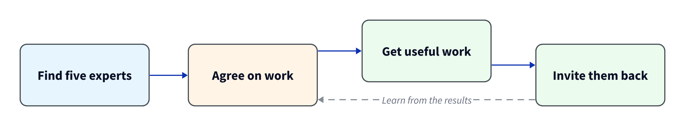

# Expert networks, built with coding agents

Deepline gives coding agents the APIs, execution and database to find, recruit, manage and engage an expert network in one place. This example uses lawyers and management consultants who create scenarios, tasks and evaluations.

**The goal is more activated and retained experts:** people who produce accepted work, then return to produce more.

| Deepline provides | What the agent builds with it |
|---|---|
| API Aggregation | Search people, research experience, verify contact data and enroll eligible contacts in Lemlist. |
| Durable Execution | Run Plays as tracked steps. Save results, recover interrupted handoffs and reconcile uncertain external writes. |
| Database | Keep identity, evidence, state, contributions and relationship history together. Use that record to choose the next action. |



Start with five experts and one real task. Make the decisions yourself. Give the coding agent the cases, evidence and decisions. Have it automate the repeated steps, keeping unclear cases for human review. GitHub holds the Plays and their history; Deepline runs them.

## What is included

All **14 project Plays**, their shared code, SQL schemas, tests, synthetic CSV/JSON inputs, metric calculator, deployment and recovery utilities, research notes and editable diagrams are included. This is a reusable example, with no customer records, workspace IDs, campaign IDs, private run receipts or private document links.

There are two independent systems:

- **Synthetic lifecycle:** eight Plays model discovery through contribution review and learning. They read supplied evidence and return recommendations. They do not send messages, assign work, sign terms or pay experts.
- **Provider-backed recruiting:** six Plays search when the queue is below 100, check role and verified email, and enroll eligible contacts in a **paused** Lemlist campaign. These calls use real providers when deployed. No campaign, schedule or live deployment is included.

The recruiting queue does not automatically feed the synthetic lifecycle. Domain-fit research, platform events, payment feeds and repeat-work outreach remain integration work. Enrollment is not delivery; a verified email is not expert qualification.

## Read the example

| Document | Contents |
|---|---|
| [Quick guide](editorial/SIMPLE.md) | Data, actions, tools and outcomes for six motions |
| [Play catalog](PLAYS.md) | Every Play, inputs, outputs, dependencies and credit caps |
| [Setup](SETUP.md) | Local tests, fixture generation, schemas, publish order, bounded pilot and recovery |
| [Design](DESIGN.md) | State machine, data contracts, replay, concurrency and integration boundaries |
| [Complete workflow](WORKFLOW.md) | Demand, discovery, screening, outreach, onboarding, creation, review and retention |
| [Recruiting](refill/README.md) | Below-100 policy, filters, queue states and leasing |
| [Qualification and enrollment](refill/ENROLLMENT.md) | Evidence gates, suppression, outbox and reconciliation |
| [Outreach contract](refill/outreach-contract.md) | What must exist before real messages can be sent |
| [Metrics](METRICS.md) | North-star definition and a submetric for every state and workflow |
| [Data decisions](editorial/DATA-DECISIONS.md) | Which fields solve which recruiting and retention problems |
| [Research](RESEARCH.md) | Public sources, tool choices, cost model and limits |
| [Detailed research notes](editorial/RECRUITMENT-RESEARCH.md) | Dated source coverage, routes and illustrative costs |
| [Verification](VERIFICATION.md) | Reproducible local checks and live verification checklist |
| [Diagram options](diagrams/OPTIONS.md) | D2, Excalidraw, SVG/PNG and architecture HTML |

## Try it locally

From this folder, with Node.js, npm and Python 3 installed:

```sh
npm ci
npm test
python3 csv-input.py --expert syn-expert-1 --episode demo-2026-11-19 --out /tmp/erm-input.json
python3 metrics/calculate.py --help
```

Tests use synthetic data and mocked providers. They do not require credentials or contact anyone. See [SETUP.md](SETUP.md) before publishing or calling providers.

## Build it over time

1. Work with five experts. Record evidence, offer terms, blockers, reviewer feedback and next opportunities.
2. Implement the repeated decisions as small Plays. Preserve why each decision was made.
3. Replace one CSV at a time with platform events. Keep stable expert, task, artifact and event IDs.
4. Compare recommendations with human decisions. Connect external actions only after their rules and recovery paths are clear.
5. Improve the step that blocks accepted work or repeat contribution. A full queue is not the outcome.

This package was extracted from an iterative prototype. The public version replaces deployment identifiers and excludes operational/customer evidence. Source research is a dated design input, not a promise of current provider pricing or predictive accuracy.
