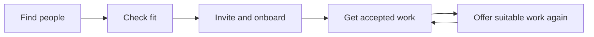

# Build an expert network with Deepline

Find good people, help them produce useful work, and give them a reason to return.

Deepline lets a coding agent build and run that process in one place:

| Part | What it does |
|---|---|
| **API Aggregation** | Connects people search, profile research, verified emails and Lemlist. |
| **Durable Execution** | Runs Plays, saves progress and supports recovery when a step fails. |
| **Database** | Keeps each expert's evidence, status and work history together. |

You set the rules. The agent writes the Plays. GitHub keeps the code.



## What the system needs to know

| Motion | Data → action | Outcome |
|---|---|---|
| Find | Task needs, specialty and experience → search and research profiles | Relevant candidates |
| Recruit | Role evidence, verified email and a real offer → check suppression and enroll in Lemlist | Interested experts |
| Onboard | Terms, access and availability → resolve the missing prerequisite | Ready to work |
| Review | Submission, rubric and reviewer feedback → accept or request a specific revision | First accepted contribution |
| Retain | Quality, payment status and suitable demand → resolve issues and offer more work | Repeat contribution |

**Success means activated and retained experts.** Activation is the first accepted production contribution. Retention means accepted work in a later period. Each step has a [measure](METRICS.md).

## What runs today

All **14 Plays** are included:

- **Recruiting:** search when the queue is below 100, verify current role and email, then add eligible contacts to a **paused** Lemlist campaign.
- **Lifecycle demo:** synthetic inputs model qualification, onboarding, matching, review and follow-up recommendations.

The two flows are separate. Task-specific fit review, live platform/payment events, message sending and repeat offers still need integration. The example contains no customer data or configured live destination.

## Start with five experts

Pick one task. Work with five people yourself. Record your decisions and the reasons they stall or return. Ask the coding agent to automate the repeated steps, keeping unclear cases for review. Replace the CSVs with real events as the process becomes clear.

To run the local tests:

```sh
cd examples/expert-network
npm ci
npm test
```

Tests use synthetic data and mocked providers. Read [Setup](SETUP.md) to deploy, or [All 14 Plays](PLAYS.md) to inspect the code.
