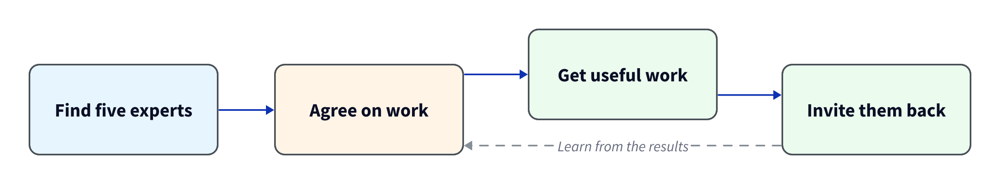

# Run your expert network with Deepline

Deepline gives coding agents the APIs, execution and database to find, recruit, manage and engage your expert network in one place. The goal: more experts who produce useful work and come back.

You describe the outcome. The coding agent builds the Plays. Deepline connects the tools, runs the steps and stores what happened.

| Deepline provides | What it does | Expert network example |
|---|---|---|
| API Aggregation | Gives the agent one place to find and call tools for search, research, contact data and outreach. | Find lawyers, research their work, get verified emails and add eligible contacts to Lemlist. |
| Durable Execution | Runs the Play as tracked steps, with saved progress and recovery logic. | Check the queue, find candidates, qualify them and enroll them. Record each result so the workflow can recover from an interrupted run. |
| Database | Keeps the expert record and workflow history together. | Store specialty, fit evidence, contact status, availability, contributions and reasons people stop. Use that history to choose the next action. |

For example: when the queue falls below 100, a Play finds more people, checks fit and contact data, saves the results and adds eligible contacts to Lemlist. Later Plays use contribution quality and availability to offer suitable work again. External actions need duplicate checks; durable execution alone does not prevent duplicate outreach.

Start with five experts and one project. Make the decisions yourself. Have the coding agent turn the steps you repeat into Plays, then improve them as you learn.

## What each Play does

| Play | Data it uses | What it does | Tools | Outcome |
|---|---|---|---|---|
| Find people | Task needs, specialty, firm, role and profile | Search for relevant people; remove duplicates | Deepline people search and Customer DB | A shortlist worth reviewing |
| Check fit | Current role, relevant projects, credentials where needed and a work sample | Verify the evidence; explain fit and unknowns | Deepline profile lookup; Exa web research; registry checks; human review | A task-specific fit decision |
| Invite | Verified email, project evidence, scope, pay and availability | Explain why the task fits; record the reply | Deepline email lookup and Lemlist | An interested expert, or a reason they declined |
| Get started | Accepted offer, terms, task brief and missing access | Check prerequisites; send each blocker to its owner | A form, your task platform and Customer DB; CSVs first | An expert ready to work |
| Review work | Submission, rubric, reviewer notes and revisions | Accept useful work or explain what to change | Your task platform and human reviewer; Deepline stores the result | A first accepted contribution |
| Bring them back | Work quality, payment status, availability and the next suitable task | Fix unresolved issues; make a relevant next offer | Customer DB, payment-status feed and Lemlist; CSVs first | Another accepted contribution |

This is the target flow. The table names the tools each Play would connect, not a claim that every connection is live.

A lawyer's title does not tell you whether they can write a good contract scenario. A short sample gives you better evidence. If they accept but never start, check whether they have access before sending another reminder.

## Where Deepline fits

A state says where the expert is: interested, ready, working or returning. A Play does the work between states: research a person, check fit, prepare an offer or follow up on a blocker.

At first, you make the decisions. The coding agent turns repeated steps into Plays. Deepline runs them and keeps the results. GitHub keeps the code and its history.

Tell the agent: “Here are five cases and the decisions we made. Build the steps we repeated. Show me the evidence and leave unclear cases for review.”

## What to measure

Count experts who make a first accepted contribution, then those who contribute again. Watch where people stop: fit, offer, readiness, review or return. Improve that step.

For example, no second contribution may mean you never offered suitable work. Keep offer history so you can tell the difference.

## What exists today

The included recruiting Plays search profiles, check current roles and work emails, and add eligible contacts to your configured paused Lemlist campaign. This public example is not deployed. Task-fit research and the full expert journey still need integration. CSVs stand in for missing platform data; payment data is a proposed addition.

## Details, if you need them

See the [Play catalog](../PLAYS.md), [data examples](DATA-DECISIONS.md), [metrics](../METRICS.md), [setup](../SETUP.md) and [research](../RESEARCH.md).
