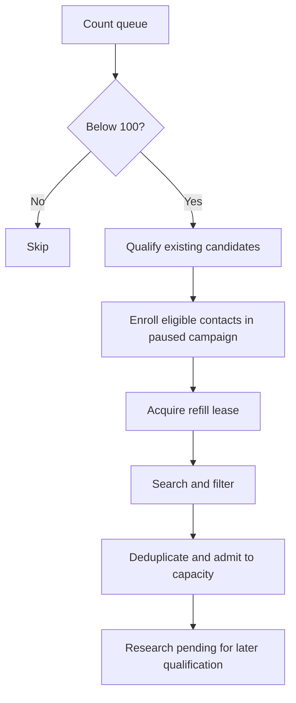

# Keep the recruiting queue supplied

`erm-refill-experts-v1` calls the source Play only when fewer than 100 distinct active profiles remain. Active statuses are research_pending, ready, contacted and onboarding; suppressed records are excluded. Already-active experts, declined and rejected records are not in this backlog.

The default allowlist in [policy.ts](policy.ts) contains illustrative large law and consulting firms. Change it for your task and market before using real providers. These are sourcing examples, not customer organizations or a quality ranking.

The source requires a name, LinkedIn profile, expected employer domain, US-reported country and relevant practitioner title. It excludes recruiting, HR, administrative and similar roles. Results enter as research_pending. A title does not establish specialist fit, registration, interest or availability.

Refill takes a 15-minute database lease, searches at most five firms with at most 25 results each, and inserts only up to remaining capacity. Profile URLs are normalized and deduplicated; inserts check the current lease token. At 100 or above there are no sourcing calls. A run may return fewer people than requested.

The full entry point is [erm-recruitment-cycle-v1](erm-recruitment-cycle.play.ts). Its order is qualification, then refill. Use the qualification batch independently when the queue is full. Read [ENROLLMENT.md](ENROLLMENT.md) and [setup](../SETUP.md) before running it.

No schedule is shipped. Recurring operation requires trigger permissions and configuration in your workspace. Writing rows alone does not invoke a Play.
