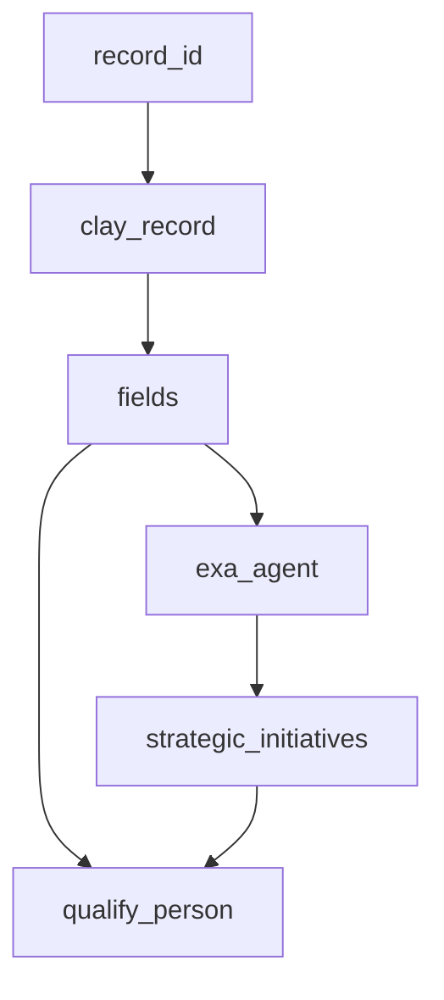

# Clay → Deepline Migration

Convert Clay tables to custom Plays: one callback-based `withColumn` per Clay
column, per `deepline plays --help`. Preserve the extraction,
payload, prompt, dependency, and parity knowledge below. The linked
[action mappings](../references/clay-action-mappings.md) retain explicitly
marked legacy template notation; those blocks are not runnable Play syntax.
For execution authority, pilots, and retrieval, use
[build, run and retrieve](../SKILL.md) in the GTM skill.

## Choosing your migration target

Every migration targets a Deepline play. The shape differs by table:

| Signal in Clay table                                                        | Target play shape                                                    |
| --------------------------------------------------------------------------- | -------------------------------------------------------------------- |
| Batch rows, no triggers, one-time or manual re-runs                         | CSV-input play: one `.withColumn(...)` per Clay action (this recipe) |
| **Function (subroutine) table**: "Function inputs" source + `write-to-cell` | Reusable play with a typed input contract (see below)                |
| Webhook trigger, `route-row`, CRM writes, campaign pushes                   | Custom play with triggers/orchestration (`deepline plays --help`)    |
| Hybrid: batch enrichment + downstream push                                  | CSV-input play first, then a second play for the push                |

Most Clay tables are batch tables. This recipe covers that path end-to-end;
for trigger/routing tables, **Extraction and Documentation still apply** — then
follow `deepline plays --help` with the extracted config as the
source artifact.

**Recognize a Clay Function before you plan the migration.** If the extract has a
`type: "source"` field named "Function inputs" (`f_subroutine_source`) and a
`write-to-cell` action, the table is a reusable subroutine, not a batch lead
list. Its input is the caller's parameter row — every column reads
`{{f_subroutine_source}}?.["<Input Name>"]`, and the `write-to-cell` `data`
`formulaMap` is the output schema. Migrate it as one self-contained play with
that input contract and drop the Clay-internal `write-to-cell` write-back; a
Deepline play returns its columns directly. The extraction reference's **Clay
Functions (subroutine tables)** section has the full signature and the
input/output/body capture map — read it whenever these signals appear.

---

## Fast path: a whole Clay workspace with the Clay CLI

Use this first when the user has the [Clay CLI](https://github.com/clay-run/agent-plugins)
(`clay`) installed. It needs no browser cookie, and it is read-only against Clay. It
converts every table in the workspace and proves formula parity on real rows
before any paid Deepline call.

```bash
clay login && clay workspaces list && clay workspaces switch <workspace-id>
S=<this skill>/scripts/clay-to-deepline.mjs        # Node 18+, no npm dependencies
node $S export  clay-export --rows 25              # read-only: tables, columns, functions, 25 full rows per table
node $S compile clay-export                        # plays/*.play.ts + *.clay.js, seeds/*.csv, migration-report.json
node $S parity  clay-export                        # every formula and lookup cell vs Clay's stored value; exit 1 on a mismatch
node $S check   clay-export                        # deepline plays check on every play (free, no run)
node $S sample  clay-export --table t_x --column "Work Email" --row-ids r_a,r_b   # one column + its inputs as a pilot play
node $S selftest                                   # Clay-semantics assertions, no network
```

Add `--tables t_a,t_b` to `export` for a subset. Run `compile` and `check` from a
folder pinned to the target Deepline workspace: `compile` reads tool schemas with
`deepline describe`, and `check` validates credentials there. A provider that is
not connected in that workspace (for example HeyReach) fails `check` until it is
connected.

**Keys: have the user add theirs.** `export` records which connection each Clay
action ran on (`clay app-accounts list`: the workspace's own key, or Clay's shared
one). `compile` writes `keys.json`, one row per Deepline provider, from
`deepline describe`. Before any run, show the user that table and ask them to
connect:

- every `deeplineKey: required` provider (CRMs, sequencers: HubSpot, Salesforce,
  HeyReach). Deepline has no managed access, so these plays fail until connected.
- every `optional` provider where `clayKeys` includes `own`: they paid that vendor
  directly in Clay, so they keep their contract and rate in Deepline.
- `optional` providers that ran on Clay-managed keys run on Deepline credits. A key
  is optional.

The user connects each with `deepline tools connect <provider>` (owner or admin;
OAuth providers open a browser), or at the `setupUrl` in `keys.json`. Suggest
`! deepline tools connect <provider>` so it runs in their session. Never ask for a
key in chat, and never connect one yourself. Re-run `check` afterwards.

What each output is for:

| Output                                           | Use                                                                                                                                                                                                                                                                                                                                                                                                                                                                                                                               |
| ------------------------------------------------ | --------------------------------------------------------------------------------------------------------------------------------------------------------------------------------------------------------------------------------------------------------------------------------------------------------------------------------------------------------------------------------------------------------------------------------------------------------------------------------------------------------------------------------- |
| `plays/<table>.play.ts`                          | One play per Clay table. Formula columns are local `withColumn`s, actions are tool calls, run conditions are `runIf`, and columns are dependency-ordered.                                                                                                                                                                                                                                                                                                                                                                         |
| `plays/<table>.clay.js`, `plays/clay-runtime.js` | Clay's own JS formulas and Clay semantics, as plain JS imported by the play. `parity` imports the same files, so the parity result is about the code the play runs.                                                                                                                                                                                                                                                                                                                                                               |
| `seeds/<table>.csv`                              | The exported rows' input columns: a ready pilot CSV.                                                                                                                                                                                                                                                                                                                                                                                                                                                                              |
| `migration-report.json`                          | Every column with `kind` (seed, formula, local, lookup, waterfall, action) and `status` (compiled, mapped, needs_review, unmapped), the mapped tool and provider, `substitute` when the Clay vendor is not in Deepline, `sameCapability` when Deepline runs the same search on another provider, `resolveTool` for a two-step id lookup, `reuses` when the call is identical to an earlier column's, and why a column needs review. Waterfall columns list their `steps` in Clay order, each with the provider column it returns. |
| `keys.json`                                      | One row per Deepline provider: `required`/`optional`/`managed`, whether Clay used the user's own key, and the `deepline tools connect` command.                                                                                                                                                                                                                                                                                                                                                                                   |
| `parity-cells.csv`, `parity-columns.json`        | The per-cell and per-column parity verdicts to show the user.                                                                                                                                                                                                                                                                                                                                                                                                                                                                     |

**Clay semantics the compiler reproduces** (each was found as a parity failure on a
real workspace and is now covered by `parity`):

- A Clay formula is a JavaScript expression, not a template. Raw newlines inside
  string literals are legal in Clay and are escaped.
- `{{column}}` on an action or source column reads its structured `fields`. Its
  `value` is only a display string ("❌ No Record Found"), so a column without
  `fields` reads as empty.
- `{{column}}?.a?.["b"]` resolves as one path lookup: a missing column or path is
  `''` (falsy, and empty in string concatenation), never `"undefined"`.
- Output is trimmed text, then typed by the column's data type: `url` and `email`
  values that fail validation become empty, `date` becomes ISO UTC, and text over
  about 8 KB becomes empty (inferred: kept 8,055 characters, dropped 8,422).
- `Clay.formatForJSON(x)` escapes text for use inside an already-quoted JSON string.
- `moment`/lodash calls run on a small built-in UTC subset (`format`, `isSame`,
  `isSameOrAfter`, `diff`, `toISOString`, `_.uniq`, `_.keys`). Extend
  `clay-runtime.js` when the compile report shows another.
- `lookup-row-in-other-table` returns the first match in creation order as
  `{ record }` keyed by the target's Clay column names (`lookup-multiple-rows`
  returns `{ records, numberOfResults }`). The play takes the target table as a
  CSV input, `lookup_<tableId>`, with Clay column names as headers. That is Clay's own CSV
  export.

**Waterfalls.** A Clay waterfall is a merge column (`formulaType: waterfall`) over
N provider columns. Each provider column has a run condition that skips it once an
earlier step found a value that passed its validator. The compiler keeps all of
it: the merge becomes `__clay.waterfall(step1, step2, ...)` (first non-empty, in
the user's order), and each provider column keeps its own `runIf`. Vendors map
like this:

- Same vendor whenever Deepline has it (Findymail stays Findymail, `find-email-v2`
  is Hunter, `validate-email` is ZeroBounce, `enrich-person` is PDL). The vendor
  comes from the connection type, not the action key.
- Same capability: Clay's Google `google-company-to-domain` is the same Google
  search on Serper (`serper_google_search`); `__clay.searchDomain` takes the
  first organic result's host without `www`. The report marks it
  `sameCapability`, not `substitute`.
- Dealroom and Crunchbase take their own entity ids, so the column makes two
  calls: a search by the company domain (`dealroom_search_companies`,
  `crunchbase_search_organizations`) finds the id (`__clay.entityId`), then the
  funding tool runs on it (`dealroom_get_company_by_id`,
  `dealroom_get_company_fundings`, `crunchbase_get_organization`). Each call is
  skipped when its input is empty. Both vendors need the user's own key
  (`required` in `keys.json`), so `check` fails until it is connected.
- A vendor Deepline lacks gets a substitute from an ordered pool. The pool skips
  providers the table already runs, so a 10-step waterfall stays on distinct
  providers. One Clay vendor maps to one provider per table, and an identical call
  reuses the earlier column's result instead of paying twice. A waterfall's `note`
  says when Deepline has fewer distinct providers than the Clay waterfall.
- Clay formulas and run conditions read Clay's field names (`{{finder}}?.email`).
  Provider columns are read through `__clay.view`: a name on the object resolves
  directly (so parity on Clay's cells stays exact); otherwise it is the first
  non-null field of that name in the Deepline response, with known renames
  (FullEnrich `most_probable_email` is `most_probable_work_email`). Without it,
  every gate reads empty and every step runs.
- A tool call whose required input is empty is skipped, as in Clay.

Pilot one waterfall with `sample`. It writes the column and only the columns it
reads (no CRM writes) as its own play, plus a seed of the chosen Clay rows. Run it
with `--max-credits`, then compare each row's step trace with the step Clay hit.
Clay's stored hits can be months old, so a same-vendor miss today is a data
difference, not a mapping bug. Check that later steps did not run after a
validated hit.

**Reading `parity`.** It rebuilds each row from Clay's own input cells and compares
every formula cell with Clay's stored value. A clean run reports `mismatch: 0`.
Report the other verdicts as counts, never as matches:

| Verdict                           | Meaning                                                                                                                               |
| --------------------------------- | ------------------------------------------------------------------------------------------------------------------------------------- |
| `match`                           | Same value. For formulas that read the current time, "same" means both are empty or both are non-empty. Report that count separately. |
| `clay_not_evaluated`              | Clay never computed the cell (status `empty`); the play would compute it.                                                             |
| `clay_stale_input` / `clay_stale` | An input is empty or marked stale, so Clay's value predates its inputs.                                                               |
| `dangling_ref`                    | The formula reads a deleted Clay column. Fix the formula in Clay or in the play.                                                      |
| `clay_error`                      | Clay errored and the play produced no value.                                                                                          |
| `not_in_sample`                   | Lookup only: Clay's matched row is outside the exported sample. Raise `--rows` to cover it.                                           |
| `target_changed_later`            | Lookup only: the matching target row or column is newer than this row, and Clay does not re-run lookups when the target changes.      |

`parity` covers formula, local transform, lookup and waterfall-merge columns, which
are deterministic and must match 100%. Provider and AI columns return live data,
so validate them on a paid pilot (`sample`, then §7). A formula that reads a
provider output path is `config-inferred` until a pilot shows the path resolves
on a Deepline response. A substitute vendor's shape can differ more than a same
vendor's.

**Still manual** (the compiler emits a column that throws, plus the reason, so a
run fails loudly instead of skipping): `route-row`, `write-to-other-table-v2`,
`trigger-find-people-source`, `lookup-company-in-other-table`, Google Docs writes,
and Google Sheet upserts. Clay Functions are inventoried with their inputs and actions,
but not compiled: `clay functions get` returns an XML schema with action display
names, not action keys. Port each one as a reusable play.

---

## §1 Extraction

Prefer the Clay CLI fast path above. Without the Clay CLI (no extract JSON provided), read [clay-extraction.md](../references/clay-extraction.md) for MCP and script-based extraction paths, API endpoints, config structure, and input data formats.

The full observed Clay internal API - every endpoint, plus how to pull the 1398-action catalog with input/output schemas - is in [clay-api-surface.md](../references/clay-api-surface.md). Go there when an `actionKey` is not covered by the mapping table, when you need a table's source filter criteria, or when you want a workbook's real dependency graph instead of deriving one.

If the user already provided an extract JSON or Clay export, skip to §2.

---

## §2 Phase 1: Documentation (Always First)

Produce before writing any scripts. Get user confirmation before Phase 2.

### 2.1 — Table Summary

| #   | Column Name | Clay Action | Tool/Model | Output Type | Notes |
| --- | ----------- | ----------- | ---------- | ----------- | ----- |
| 1   | `record_id` | built-in    | —          | string      |       |
| …   |             |             |            |             |       |

### 2.2 — Dependency Graph (Mermaid)



Use `classDef` colors: blue = local (`run_javascript`), orange = remote API, green = AI (`deeplineagent`).

### 2.3 — Pass Plan

**Column alias rule:** Derive aliases from the actual Clay column name, snake_cased (e.g. "Work Email" → `work_email`). The two structural aliases `clay_record` and `fields` are fixed — all others follow the Clay schema. Do NOT invent names from a memorized list.

```markdown
| Pass | Column alias     | Deepline tool                 | Depends on     | Notes                                      |
| ---- | ---------------- | ----------------------------- | -------------- | ------------------------------------------ |
| 1    | clay_record      | shell fetch (`clay_curl`)     | record_id      | Loaded into the seed CSV before enrichment |
| 2    | fields           | run_javascript (flatten)      | clay_record    | alias is always fields                     |
| N    | <clay_col_snake> | <see clay-action-mappings.md> | <prior passes> | Alias = snake_case(Clay column name)       |
```

**Function (subroutine) tables use a different pass-1.** There is no lead CSV to
fetch — the input IS the caller's parameter row. Skip the `clay_record`/`fields`
fetch-and-flatten passes and make pass 1 the input contract: one alias per
declared parameter (from `SUBROUTINE_INPUTS`, or the distinct
`{{f_subroutine_source}}?.["…"]` references when `tableSettings` is absent),
sourced from the play input rather than a Clay fetch. Then one pass per
non-source, non-`write-to-cell` field in dependency order. The final "pass" is the
output projection = the `write-to-cell` `data` map; do not build a
`write-to-cell` pass.

```markdown
| Pass | Column alias     | Deepline tool                 | Depends on     | Notes                                          |
| ---- | ---------------- | ----------------------------- | -------------- | ---------------------------------------------- |
| 1    | <param_snake>    | play input                    | —              | One per SUBROUTINE_INPUTS parameter            |
| N    | <clay_col_snake> | <see clay-action-mappings.md> | <prior passes> | Non-source, non-write-to-cell fields, in order |
| out  | (projection)     | —                             | prior passes   | = write-to-cell `data` formulaMap; not a pass  |
```

### 2.4 — Assumptions Log

State every unverifiable assumption. Get confirmation before Phase 2.

### 2.5 — Prompt Extraction

**Do this before writing any prompt approximations.** Actual Clay prompt templates live in formula field cell values or in `typeSettings.inputsBinding`.

**Prompt recovery priority (richest to weakest):**

1. **HAR** — bulk-fetch-records cell values rendered formula prompts verbatim. Use directly.
2. **clay-extract.py output** — `fields[].typeSettings.inputsBinding[name=prompt].formulaText` has the full prompt. Mark as `# RECOVERED FROM EXTRACT — field f_xxx`.
3. **ClayMate `portableSchema`** — `columns[].typeSettings.inputsBinding[name=prompt].formulaText`. Mark as `# RECOVERED FROM PORTABLE SCHEMA — field f_xxx`.
4. **Approximated** — reverse-engineer from outputs or user description. Mark as `# APPROXIMATED — could not recover`.

**JSON schema recovery from portableSchema:**

```python
import json
for col in d['portableSchema']['columns']:
    if col['type'] == 'action':
        for inp in col['typeSettings'].get('inputsBinding', []):
            if inp['name'] == 'answerSchemaType':
                schema_raw = inp.get('formulaMap', {}).get('jsonSchema', '').strip('"')
                schema_raw = schema_raw.replace('\\"', '"').replace('\\n', '\n').replace('\\\\', '\\')
                schema = json.loads(schema_raw)
```

**Fix Clay formula bugs in recovered prompts:** `{{@Name}}` → `{{name}}`, `{single_brace}` → not interpolated by Deepline, `Clay.formatForAIPrompt(...)` → strip wrapper.

### 2.6 — Pipeline Architecture Verification

Check actual cell values across 3+ records before counting AI passes:

| Cell value                              | Meaning                      | How to replicate                      |
| --------------------------------------- | ---------------------------- | ------------------------------------- |
| `NO_CELL`                               | Action never fired           | Build from scratch                    |
| `"Status Code: 200"` / `{"status":200}` | HTTP/webhook action — NOT AI | `generic_http_request` or shell fetch |
| `""` (empty string)                     | Disabled or unfired          | Treat as NO_CELL                      |
| Varied generation-shaped text           | Actual AI output             | `deeplineagent`                       |

**No cell data in the extract?** Some extracts carry config only (no
`exampleRecords` / `bulkFetchRecords`). You cannot run the 3-record check, so do
not fake it: infer architecture from `typeSettings` (`actionKey`,
`conditionalRunFormulaText`, `formulaWaterfall`) and label every architecture or
parity claim **`config-inferred, unvalidated`**. Defer any conclusion that
genuinely needs real cell values until you fetch records (§ `bulk-fetch-records`)
or the user confirms.

---

## §3 Phase 2: Pre-flight + Play Authoring

### Pre-flight Checklist

Answer these **before writing the play** based on what Phase 1 revealed. Only answer questions that apply.

**Table type (check all that apply):**

- [ ] **Has a provider waterfall** (several finders of the same kind chained by `conditionalRunFormulaText`) → ONE Deepline waterfall play, not one pass per provider
- [ ] Has phone columns → use `prebuilt/person-to-phone`; confirm the input contract, it needs name + domain while many Clay finders take only a LinkedIn URL
- [ ] Has person enrichment columns → verify with `deepline search "LinkedIn profile URL -> enriched person" --type tools`. Check `inputsBinding` first: a column keyed `enrich-person` is often wired as a phone or email finder
- [ ] Has email finding columns → use `name-and-domain-to-email-waterfall` as primary play
- [ ] Has AI generation columns (use-ai, claygent, octave) → recover prompts verbatim (§2.5)
- [ ] Has scoring/qualification columns → use ICP criteria verbatim from Clay config
- [ ] Has campaign push / CRM update columns → verify with `deepline search "lead list -> leads added to a <platform> campaign" --type tools`
- [ ] Has cross-table lookups → export linked table to CSV first
- [ ] **Is a company intelligence table** (source = Mixrank) → use `crustdata_v3_company_search`

**Security (all tables):**

- [ ] `CLAY_COOKIE` in `.env.deepline` (not hardcoded), single quotes, `.gitignore`d
- [ ] `output/` in `.gitignore`
- [ ] HTTP calls use `generic_http_request` or the generated shell fetch script; `run_javascript` is only for local row transforms

### Output Files

```
project/
├── .env.deepline             # Clay credentials (never commit)
├── .env.deepline.example     # Template — safe to commit
├── .gitignore                # Excludes .env.deepline, *.csv, output/
├── prompts/
│   └── <name>.txt            # One file per AI column with source header
├── scripts/
│   └── fetch_<table>.sh      # Fetches Clay records → seed_<table>.csv
└── <table>.play.ts           # The migrated table: one column per Clay action
```

### Cookie Pattern (mandatory)

```bash
set -a; source .env.deepline; set +a
: "${CLAY_COOKIE:?CLAY_COOKIE must be set in .env.deepline}"
CLAY_VERSION="${CLAY_VERSION:-v20260311_192407Z_5025845142}"

clay_curl() {
  curl -s --fail \
    -b "${CLAY_COOKIE}" \
    -H "accept: application/json, text/plain, */*" \
    -H "origin: https://app.clay.com" \
    -H "referer: https://app.clay.com/" \
    -H "x-clay-frontend-version: ${CLAY_VERSION}" \
    -H "user-agent: Mozilla/5.0 (Macintosh; Intel Mac OS X 10_15_7) AppleWebKit/537.36 (KHTML, like Gecko) Chrome/145.0.0.0 Safari/537.36" \
    "$@"
}
```

**Never hardcode `CLAY_COOKIE` in scripts.** Use single quotes in `.env.deepline` (GA cookies contain `$`).

**How to get the cookie:** Copy a `curl` from Chrome DevTools (right-click any api.clay.com request → Copy as cURL). Extract the `-b '...'` value.

### Clay API Endpoints

| What you need   | Correct endpoint                                        | Notes                                                              |
| --------------- | ------------------------------------------------------- | ------------------------------------------------------------------ |
| All record IDs  | `GET /v3/tables/{TABLE_ID}/views/{VIEW_ID}/records/ids` | View ID required — without it returns `NotFound`                   |
| View ID         | `GET /v3/tables/{TABLE_ID}` → `.table.firstViewId`      | Always fetch dynamically                                           |
| Fetch records   | `POST /v3/tables/{TABLE_ID}/bulk-fetch-records`         | Body: `{"recordIds": [...], "includeExternalContentFieldIds": []}` |
| Response format | `{"results": [{id, cells, ...}]}`                       | Key is `results`; record ID is `.id` (not `.recordId`)             |

### Play Shape and Column Order

The migrated table is a play file: the script reads the seed CSV with `deepline.csv(...)`, chains one `.withColumn(alias, ...)` per Clay action in dependency order, and finishes with `.run({ key })`. Author it per `deepline plays --help`; columns execute in declaration order, and each column can read any earlier alias.

Validate before spending credits:

```bash
deepline plays check <table>.play.ts
```

`plays check` compiles the play and reports errors without starting a run. Order columns cheapest-first: `run_javascript` transforms before paid provider calls, so a local derivation is available to the columns that depend on it.

### Referencing Columns

Reference columns by alias, never by index. Translate legacy payload templates
to callback reads: `{{alias}}` becomes `row.alias`, `{{fields.title}}` becomes
`row.fields.title`, and `{{li_serper.organic[0].link}}` becomes the corresponding
typed array access. Use explicit missing-value handling; TypeScript does not
interpolate Clay braces or silently turn a missing path into an empty string.

### Running and Waiting

```bash
deepline plays run <table>.play.ts --csv seed.csv
deepline runs get <run-id>
deepline runs export <run-id> --out output_<table>.csv
```

Run waits until completion by default. Export preserves all dataset columns;
inspect fill rates with `deepline csv show output_<table>.csv --summary`.
Its JSON `rows` contains one summary per column, with `total_rows` analyzed and
`source_total_rows` in the file. Summary defaults to the whole file, unlike
normal display's first 20 rows; explicit `--rows` limits either mode.
Use `--columns` / `--exclude-columns` for display-only selection, not export
filtering. See `deepline csv show -h` for formats and options.

### Piloting A Subset Of Rows

For a newly migrated large table, use an authorized CSV-aware subset before
scaling. A small authorized supplied Play runs once, without a separate pilot:

```bash
# Prepare pilot.csv with a CSV parser (quoted fields may contain newlines).
deepline plays run --file <table>.play.ts --input '{"csv": "pilot.csv"}'
```

To skip rows a cheaper pass already answered, gate the expensive column with `runIf` so it only fires where the value is missing:

```ts
runIf: (row) => !row.work_email,
```

This replaces the old filter-to-a-separate-CSV-and-merge workaround. Compatible
completed tool receipts may be reused; incomplete or ambiguous work can execute
again. Do not promise that a rerun is free.

### Common Failure Modes

| Symptom                     | Cause                                         | Fix                                                  |
| --------------------------- | --------------------------------------------- | ---------------------------------------------------- |
| `{{col}}` empty in prompt   | Alias declared after the column that reads it | Move the producing column earlier in the play        |
| Interpolation renders blank | Path does not exist on that row (`{{a.b.c}}`) | Check a sample row's actual shape; fix the path      |
| Unexpected re-charge        | Input value changed between runs              | Receipts key on tool + input; identical inputs reuse |

---

## §4 Action Mapping

**Start with the job-based mapping table in [clay-api-surface.md](../references/clay-api-surface.md#map-by-job-not-by-provider-name).** Clay names one action per provider - 21 phone finders, 15 work-email finders - and those collapse into a single Deepline waterfall. Mapping provider-by-provider covers about 17% of real-table usage; mapping by job covers about 85%.

Then use [clay-action-mappings.md](../references/clay-action-mappings.md) for the exact CLI payload of a specific tool. It is a payload reference, not a complete action list: it has no phone or CRM rows. Always verify tool IDs before use.

For anything neither file maps, pull the action's real input schema from Clay's catalog (see [clay-api-surface.md](../references/clay-api-surface.md)), then map it. Do not guess from the action name.

### Unknown Action Fallback

```bash
deepline search "<input you have -> result you need>" --type tools   # the action's input and output
deepline describe <candidate_tool_id>       # inspect candidate
# if nothing found → deeplineagent fallback
```

| You see in Clay        | Search query               | Likely result                                   |
| ---------------------- | -------------------------- | ----------------------------------------------- |
| `enrich-person-with-*` | `"person enrich linkedin"` | `leadmagic_profile_search`                      |
| `find-email-*`         | `"email finder"`           | `hunter_email_finder`, `leadmagic_email_finder` |
| `verify-email-*`       | `"email verify validate"`  | `leadmagic_email_validation`                    |
| `company-*`            | `"company enrich"`         | `prospeo_enrich_company`                        |
| `add-to-campaign-*`    | `"add leads campaign"`     | `instantly_add_to_campaign`                     |

### Summary Table

| Clay action                                   | Deepline tool                                                       |
| --------------------------------------------- | ------------------------------------------------------------------- |
| Email waterfall + `validate-email`            | `name-and-domain-to-email-waterfall` + `leadmagic_email_validation` |
| `enrich-person-with-mixrank-v2`               | `leadmagic_profile_search` → `crustdata_v3_person_enrich`           |
| `chat-gpt-schema-mapper`                      | `deeplineagent` with `jsonSchema`                                   |
| `use-ai` (no web)                             | `deeplineagent`                                                     |
| `use-ai` (claygent + web)                     | Binary search optimizer — see §5                                    |
| `octave-qualify-person`                       | `deeplineagent` + `jsonSchema` ICP scorer                           |
| `add-lead-to-campaign`                        | `instantly_add_to_campaign` or `smartlead_push_to_campaign`         |
| `route-row`                                   | **Not replicable.** Produce filtered output CSV per destination.    |
| `find-lists-of-companies-with-mixrank-source` | `crustdata_v3_company_search` + optional `prospeo_enrich_company`   |

---

## §5 Binary Search Optimizer (Claygent Web Research)

Use whenever replicating a `use-ai (claygent + web)` column, as a Play: keep `exa_search` retrieval and `deeplineagent` synthesis as separate columns with explicit confidence and failure outcomes. Adapt the three angles to the use case (signals: tech stack/jobs, engineering blog, talks).

### Pass Structure

```python
# Pass A — parallel, highlights-only (cheap). Include domain in ALL queries.
queries = [
    f'"{co_name}" {domain} 10-K annual report investor relations',
    f'"{co_name}" {domain} new product launches announcements 2024 2025',
    f'"{co_name}" {domain} go-to-market new customer segments 2024 2025',
]

# Pass B — synthesis with confidence gate
schema = { ...fields..., "confidence": "high|medium|low", "missing_angles": [...] }
# confidence == "high": STOP

# Pass C — follow-up exa searches on missing_angles[0:2], text=True
# Pass D — re-synthesize
# Pass E — primary-source deep-read via _extract_primary_source_url(company_domain)
```

Always add `research_confidence` and `research_passes` tracking columns.

### Confidence Calibration (26-row data)

- `high`: 0% — essentially never with Exa
- `medium`: 35% — large public companies, funded startups
- `low`: 65% — but 50% of `low` had specific useful content

`low` ≠ bad output. Use `is_failed_research()` content quality check instead:

```python
FAILURE_MARKERS = ['UNCHANGED', 'UNRESOLVED', 'NO UPDATE', 'SOURCE INVALID',
                   'CRITICAL SOURCE MISMATCH', 'Unable to determine']
```

Expected failure rate: ~15%.

### Known Failure Modes

| Failure           | Example                         | Fix                                                      |
| ----------------- | ------------------------------- | -------------------------------------------------------- |
| Name collision    | `onit.com` → wrong company      | Quote `co_name`; add domain                              |
| No indexed source | `ziphq.com`                     | Fall back to Crunchbase + LinkedIn                       |
| URL contamination | Deep-read returns wrong company | Use `_extract_primary_source_url(company_domain=domain)` |

---

## §6 Patterns and Antipatterns

Clay-specific patterns. For general Deepline patterns (email plays, interpolation, deeplineagent, column shapes), use the prebuilt plays and the steps in the deepline-gtm skill.

### Email Match Rate

| Format                  | % of Clay emails |
| ----------------------- | ---------------- |
| `fn.ln@domain`          | 63%              |
| `fln@domain`            | 19%              |
| `fn@domain`             | 3%               |
| Provider waterfall only | ~12%             |

Use `name-and-domain-to-email-waterfall` as primary play. Accept `valid`, `valid_catch_all`, AND `catch_all` from validation (NOT `unknown`).

---

## §7 Phase 3: Validation

### Parity Thresholds

Base thresholds:

| Field type                               | Threshold                             |
| ---------------------------------------- | ------------------------------------- |
| Deterministic (formulas, fetch, scoring) | 100% exact match                      |
| LLM classification                       | ≥90% exact match on unambiguous cases |
| LLM generation                           | Tone and intent match (manual review) |

Clay-specific extensions:

| Field type                                  | Threshold                                    |
| ------------------------------------------- | -------------------------------------------- |
| Email (`work_email`)                        | DL found rate ≥95% of Clay found rate        |
| Structured (`deeplineagent` + `jsonSchema`) | All schema fields populated in 100% of rows  |
| Web research                                | `is_failed_research()` False on ≥85% of rows |

### Running the Comparison

Deterministic columns: `node <this skill>/scripts/clay-to-deepline.mjs parity <export-dir>`
(see the fast path). It needs no Deepline run.

Provider and AI columns: export the pilot run (`deepline runs export <run-id> --out pilot.csv`)
and compare each migrated column with the same Clay rows' values from the export
(`rows/<tableId>/<rowId>.json`, cell `value`/`fields`), joining on the seed
columns. Report found rate and agreement per column against the thresholds above.

### Diagnosing LLM Mismatches

Use this mismatch process: check prompt parity → check model parity → check true ambiguity (run 3x) → document, don't overfit.

---

## §8 Critical Rules

- **Declaration order is execution order**: put `run_javascript` transforms before the paid columns that read them
- **Gate expensive columns with `runIf`**: never pay for a row a cheaper pass already answered
- **Flatten first**: a `run_javascript` column that flattens `clay_record` before `{{fields.xxx}}`. Not needed in Python SDK — use `json.loads()` directly
- **Translate full paths**: preserve `{{col.field.nested}}` and `{{col.items[0].field}}` semantics as typed callback reads with explicit missing-value handling, not literal brace strings
- **Structured JSON for deeplineagent**: Single invocation per column, all fields in one `jsonSchema`
- **Cookie in env**: Never embed `CLAY_COOKIE` in play code or payloads; read it only from `.env.deepline` in the generated shell fetch script
- **Catch-all is valid**: Accept `valid`, `valid_catch_all`, `catch_all`. NOT `unknown`
- **Prompts verbatim**: Use exact text from source — small differences cause systematic drift

---

## §9 Migration Checklist

1. **Extraction (§1)**: Extract Clay table config (or skip if user provides extract)
2. **Phase 1 (§2)**: Table summary, dependency graph, pass plan, prompt extraction, assumptions
3. **Confirm**: Resolve material assumptions and execution authority; planning alone permits no paid run
4. **Phase 2 (§3)**: Pre-flight → write `fetch_<table>.sh` + `<table>.play.ts`
5. **Check and pilot**: `deepline plays check` (no provider spend), then an authorized bounded pilot for larger unproven work; no duplicate small supplied run
6. **Full run**: Complete the approved scope without redundant post-pilot approval; ask if scope, cost, or risk changes
7. **Phase 3 (§7)**: `clay-to-deepline.mjs parity` reports `mismatch: 0` for deterministic columns; pilot comparisons meet the thresholds for provider and AI columns
8. **Trigger/routing migration** (optional): If table needs triggers/routing → `deepline plays --help`

### Pilot Gate

Pure transforms can be checked locally. For a newly migrated large paid batch,
check first, then use an authorized pilot. Account for processed rows when
scaling; do not repeat them solely to satisfy a full-run ritual:

```bash
deepline plays check <table>.play.ts                                        # step 1: compile only, no spend
# Prepare pilot.csv with a CSV parser; seed.csv below is the remaining scope.
deepline plays run --file <table>.play.ts --input '{"csv": "pilot.csv"}'   # step 2: 3 rows, real providers
deepline plays run --file <table>.play.ts --input '{"csv": "seed.csv"}'    # step 3: all rows
```

`plays check` compiles the play without spending credits. It still calls the Deepline compile API, so it needs auth and network — it is not an offline check.
